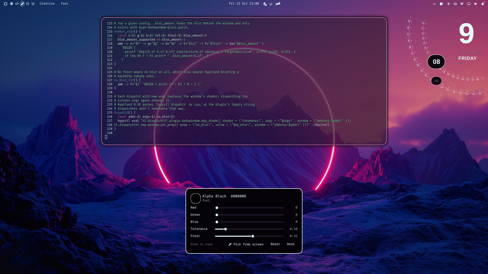
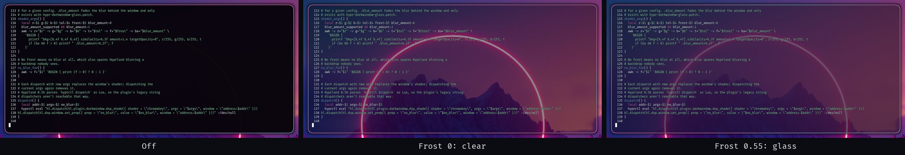

# Alpha Black

Make black (or any color you pick) in a window see-through on
[Omarchy](https://omarchy.org), as clear glass or frosted glass.



Run it on the focused window and every pixel of that color turns
transparent, so your wallpaper and the windows behind show through. It
works well for terminals, video letterboxing, and dark-themed apps.
Near-matches fade out gradually, so text keeps clean edges.



## Install

```bash
omarchy plugin add https://github.com/CornillieJ/omarchy-alpha-black.git --enable
```

The first time you use it, Alpha Black builds the Hyprland plugin it relies
on (see [Requirements](#requirements)). That takes under a minute, and a
notification tells you it's happening.

## Use

Enabling the plugin adds **Alpha Black** to the Omarchy menu (Trigger) and
to menu search. Run it on a window and:

- **If the window is off**, it turns see-through and the editor opens. Tune
  it while you watch, then press **Enter** to close the editor.
- **If the window is already on**, it turns back to normal. No editor.

Turning a window back on reopens the editor with that window's last
settings.

| Editor control | What it does |
|---|---|
| Red / Green / Blue | The color that becomes see-through. Black by default. |
| Tolerance | How close a pixel has to be to that color to be affected. |
| Frost | 0 is clear glass. Higher values blur what shows through, up to fully frosted at 1. |
| Pick from screen (`P`) | Grab the color under the cursor with hyprpicker. |
| Reset | Back to black, tolerance 0.10, frost 0. |
| Enter / Escape / Done | Close the editor and keep the settings. |

Settings are remembered per window until you log out.

Prefer a keybinding? Add one to `~/.config/hypr/bindings.lua`:

```lua
o.bind(hyper .. "B", "Alpha Black", "~/.config/omarchy/plugins/jeffrey.alpha-black/alpha-black")
```

## Requirements

The transparency is done by the
[Hypr-DarkWindow](https://github.com/micha4w/Hypr-DarkWindow) Hyprland
plugin. You don't install it yourself. Alpha Black clones it into
`~/.local/share/hypr-darkwindow` and builds the commit that matches your
Hyprland version. It does this on first use and again after every Hyprland
update.

Building needs `git`, `make`, `g++`, `pkg-config` and the Hyprland headers.
All of them come with a standard Omarchy install. `hyprpicker` (also
standard) is used for Pick from screen.

## Uninstall

```bash
~/.config/omarchy/plugins/jeffrey.alpha-black/alpha-black uninstall
```

This asks for confirmation, then:

- removes the plugin (`omarchy plugin remove jeffrey.alpha-black`)
- turns Alpha Black off on every window and unloads Hypr-DarkWindow, if
  Alpha Black loaded it
- deletes `~/.local/share/hypr-darkwindow`, but only if Alpha Black cloned
  it there. If you already had something at that path before Alpha Black
  first ran, it stays.
- removes the `trigger.alphablack` entry from
  `~/.config/omarchy/extensions/omarchy-menu.jsonc`. If the file wouldn't
  parse afterwards, it's left untouched and you're told to remove the entry
  by hand.
- deletes its own state in `~/.local/state/alpha-black`

`omarchy plugin remove jeffrey.alpha-black` on its own removes only the
plugin folder and leaves the rest behind.

## What's unusual in here

This section is for when something goes wrong. These are the places where
Alpha Black does something you might not expect.

**It builds and loads a Hyprland plugin at runtime.** Hypr-DarkWindow is a
compiled `.so` that only loads into the exact Hyprland build it was compiled
against. Alpha Black builds it from a pinned commit:

- first from its own list of tested pins
  ([`darkwindow-pins`](darkwindow-pins))
- then from the pin Hypr-DarkWindow publishes for your Hyprland release in
  its `hyprpm.toml`

It never builds an unpinned branch. If neither list knows your Hyprland
version, you get a notification instead of a build.

The `.so` is loaded the first time you use Alpha Black in a session, never
from your Hyprland config. A plugin that breaks after a Hyprland update
can't stop your session from starting. Loading it runs `hyprctl reload`
once, because Hypr-DarkWindow only registers its shaders during a config
load.

**It patches Hypr-DarkWindow before building**
([`hypr-darkwindow-glass.patch`](hypr-darkwindow-glass.patch)):

- *Blur behind shaded windows.* Apps that use the `ext-background-effect`
  Wayland protocol, like foot, only get blur where they ask for it. When
  their own background is opaque, they ask for none. The patch hooks
  Hyprland's `IHyprRenderer::shouldBlur(window)` so a window whose shader
  makes it transparent still gets blur behind it. It respects `no_blur` and
  `decoration:blur:enabled`.
- *Frost.* Hyprland draws the blurred background as its own layer under the
  window. The patch adds a `.blur_amount` shader property that fades that
  layer, which is what the Frost slider sets.
- *Exact-overload hooks.* Hypr-DarkWindow finds the functions it hooks by
  name prefix, and `shouldBlur` has three overloads. The patch lets a hook
  name one exact signature.

If a future Hypr-DarkWindow version no longer takes the patch, Alpha Black
builds it unpatched and tells you. Frost then becomes all-or-nothing, and
apps like foot won't blur.

The same applies if Hypr-DarkWindow was already loaded by something else
(hyprpm, your own config). Alpha Black uses it as-is and assumes it's
unpatched.

**It changes `no_blur` on the windows it touches.** While a window is on
with Frost at 0, its `no_blur` property is set to 1, so a blurred backdrop
doesn't hide what's behind. Turning the window off sets `no_blur` back to 0.
That overrides any `no_blur` window rule you had for that window until it
reopens.

**It talks to Hyprland through `hyprctl eval`.** Hyprland 0.56 parses
`hyprctl dispatch` as Lua, so Hypr-DarkWindow's legacy string dispatchers
aren't reachable. Alpha Black dispatches through the Lua API instead.

**It tracks state itself.** Hypr-DarkWindow can't report which windows are
shaded, and it toggles a shader off when the exact same shader string is
dispatched again. Alpha Black keeps each window's on/off state and settings
in `$XDG_RUNTIME_DIR/alpha-black/windows`. If that gets out of sync (say,
you unloaded Hypr-DarkWindow by hand), toggling a window twice brings it
back in line. Logging out resets everything.

**It adds itself to your menu.** The first time the plugin loads, it adds a
`trigger.alphablack` row to `~/.config/omarchy/extensions/omarchy-menu.jsonc`.
It checks that the file still parses before and after the edit and skips
the edit otherwise. It only does this if the key isn't already there, so
moving or editing the row by hand sticks.

### Files it creates

| Path | What |
|---|---|
| `~/.local/share/hypr-darkwindow/` | Hypr-DarkWindow source and build (`out/hypr-darkwindow.so`) |
| `~/.local/state/alpha-black/install.json` | Whether that folder existed before Alpha Black, for uninstall |
| `$XDG_RUNTIME_DIR/alpha-black/` | Per-session window state and lock |

## Troubleshooting

- **"Building Hypr-DarkWindow failed"**: run
  `make -C ~/.local/share/hypr-darkwindow` to see the compiler error.
  Usually Hyprland was updated and its headers don't match the pinned
  commit yet.
- **Frost does nothing**: check that blur is on
  (`hyprctl getoption decoration:blur:enabled`) and that no window rule sets
  `no_blur` for that app.
- **The editor looks out of date after updating the plugin**: run
  `omarchy-restart-shell`.
- **Toggling seems inverted on a window**: toggle it twice (see state
  tracking above).

## Credits

- [Hypr-DarkWindow](https://github.com/micha4w/Hypr-DarkWindow) by micha4w
  (MIT), which does the shading
- The chromakey shader in Hypr-DarkWindow, originally by ikz87

## License

MIT
